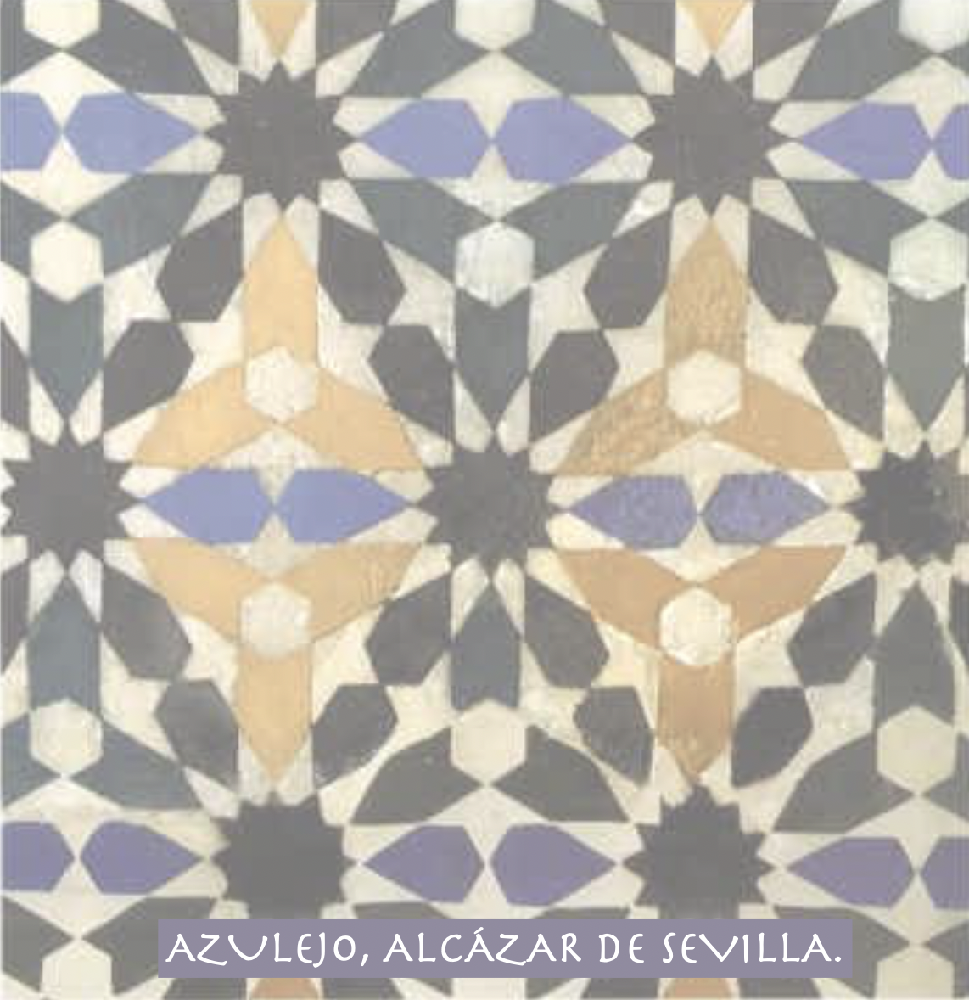

  <a href="/" style="color:#ffffff; text-decoration:none;">Home</a>
  &nbsp;|&nbsp;
  <a href="/publications.html" style="color:#ffffff; text-decoration:none;">Publications</a>
  &nbsp;|&nbsp;
  <a href="/CAenSevilla" style="color:#ffffff; text-decoration:none;">Algebraic Combinatorics at Sevilla</a>
  &nbsp;|&nbsp;
  <a href="/divulgacion.html" style="color:#ffffff; text-decoration:none;">Divulgación</a>
  &nbsp;|&nbsp;
  <a href="/coautores.html" style="color:#ffffff; text-decoration:none;">Collaborators</a>
  &nbsp;|&nbsp;
  <a href="https://personal.us.es/mrosas/elalfilmatematico/index.html" style="color:#ffffff; text-decoration:none;">Alfil Matemático</a>
  &nbsp;|&nbsp;
  <a href="https://ev.us.es/" style="color:#ffffff; text-decoration:none;">Docencia</a>

<H1> Combinatoria Algebraica en Sevilla </H1>

<H2> Grupo de Trabajo:</H2>

- Este grupo de trabajo se reune todos los jueves en un seminario informal sobre temas recientes en Combinatoria Algebraica.

<H2> Participantes:</H2>

- [Emmanuel Briand](http://emmanuel.jean.briand.free.fr/) 
> Profesor, \
> Universidad de Sevilla, Departamento de Matemáticas Aplicadas 1.

- [Aram Dermenjian](https://dermenjian.com/)
> Profesor,\
> Universidad Loyola, Sevilla.

- [Mercedes Rosas](https://mhrosas.github.io/)
> Profesora,\
> Universidad de Sevilla, Departamento de Álgebra.

-  [Adrian Lillo](https://www.linkedin.com/in/adri%C3%A1n-lillo-pinto-1b1359180/).
> Adrian is a PhD student at the University of Sevilla. 
> Building on our decomposition of a Cayley tree via records,
> closely related to the blob encoding of Kreweras, Moszkowski,
> and Picciotto, we define parking functions anew and construct
>  a record-preserving bijection with Cayley trees. This leads
>  to an equidistribution of six statistics on both structures.
> More recently, we have been looking at the record generating functions for trees and forests.
> A Maria de Maetzu grant funds his PhD research.

-  [Aaron Ocampo](https://www.linkedin.com/in/aar%C3%B3n-ocampo-amaya-b227ba310/?originalSubdomain=es)
> Aaron is a PhD student at the University of Sevilla. 
> Aaron is working towards his doctorate degree with a FPU fellowship. At the moment,
> Aaron is studying the hook stability phenomena present for the much-studied Kronecker coefficients of
> the symmetric and the linear general group, and its
>  connection to FI-modules.

- Luis Calvo Sánchez
> Luis is a PhD student at the University of Sevilla. 
> Luis wrote his senior and his master thesis on a higher dimensional version of the
>  Combinatorial Laplacian defined in the framework of algebraic topology. Luis's work is based on results of Kalai, Bernardi and Klivans.
> Luis is currently writing up the results of his investigation.

- Giovanni Critelli
> Giovanni is starting his senior tesis with us.  

<H2> Experimental mathematics:</H2>

- Emmanuel Briand mantains a [Database of Piecewise Quasipolynomial Functions](https://doi.org/10.5281/zenodo.15375088).
> A quasipolynomial is a function on integer points given by several polynomials: one for each coset of some
> full-rank sublattice. The piecewise quasipolynomial functions considered here have as  domains of quasipolynomiality 
> the maximal cells of a fan subdividing a cone, and are zero outside this cone. 
> This database provides a full description of some small multiplicity functions from representation theory that are
> piecewise quasipolynomial in this sense. This includes or will include families of  Littlewood-Richardson
> coefficients, Kronecker coefficients, Plethysm coefficients and alike.

- Adrian Lillo's SageMath notebook [Weary drivers](https://github.com/adrianlillo/weary_drivers)
>  the record-preserving  bijection and the various statistics appearing in
>  our work on record codes and parking functions. 

- Emmanuel Briand's SageMath notebook [the144symmetries](https://nbviewer.org/url/emmanuel.jean.briand.free.fr/publications/the144symmetries.ipynb)
> We perform explicit calculations with sagemath to show that the Littlewood-Richardson coefficients
> associated to the representation theory of SL3 afford a group of 144 linear symmetries, which is more than the 12.

- Emmanuel Briand's SageMath notebook [On the growth of the Kronecker coefficients: Companion Worksheet](https://nbviewer.org/url/emmanuel.jean.briand.free.fr/publications/HookStability.ipynb)
> This notebook implements some of the calculations presented in the preprint On the growth of the Kronecker
> coefficients (Emmanuel Briand, Amarpreet Rattan, Mercedes Rosas; 2016
>  Our calculations also show that this group of symmetries acts transitively
> on the set of chambers of the corresponding chamber complex. As a consequence, the data of the group
> and of only one chamber (with the formula for the LR on this chamber) completely describe these LR coefficients.

<H2> Antiguos Estudiantes y visitantes:</H2>

- [Laura Colmenarejo](https://sites.google.com/view/l-colmenarejo/home)
> Laura finished her PhD thesis titled "Stability in the combinatorics of representation theory" in 2016. 

> Laura, a rising star in the area of Algebraic Combinatorics,  currently hold a tenure track position at North Carolina State Univesity.

  
  
- [Stefan Trandafir](https://sites.google.com/view/stefan-trandafir)
> Stefan was a frecuent visitor to the group during
>  his PhD at Simon Fraser University in Vacouver. During
> this time, he delved into some ideas regarding the
> study of Kronecker coefficients, which partially stemmed
> from our group's discussions.
> Additionally, he discovered a new
> symmetry exhibited by the Littlewood-Richardson
> coefficients. Afterwards, Stefan came back to Sevilla for 
> postdoctoral position with the quantum information group of
>  Adan Cabello (Sevilla).
>  During this second period, Stefan collaborated with us on questions related to
> records of trees and forests.
  
- [Álvaro Gutiérrez Cáceres](https://sites.google.com/view/gutierrez-caceres/)
> Álvaro's undergraduate senior thesis yielded two
> publications on the study of the plethysm of
> symmetric functions. Following his time in
>  Sevilla, Álvaro authored a Master's thesis at the
> University of Bonn under the supervision of Catharina
> Stroppel and Jacob Matherne.  

>, Álvaro is currently finishing 
>  his Ph.D. under the guidance of Mark Wildon at
> Bristol University.

- [Luis Esquivias](https://www.linkedin.com/in/luis-esquivias-quintero-60214a264/).
> Luis's and [Adrian Lillo](https://www.linkedin.com/in/adri%C3%A1n-lillo-pinto-1b1359180/) senior's thesis were the result
> of a collaboration with [Álvaro Gutiérrez Cáceres](https://sites.google.com/view/gutierrez-caceres/), and the senior members of the group.
>  We provided a combinatorial proof of the Graham and Pollak formula for the determinant of the distance matrix of a tree, utilizing
>  the Gessel-Viennot involution. 

>  Luis is working towards his PhD in Sevilla, this time focusing in number theory, and under the direction of Antonio Rojas and Alberto Castaño.

- Pablo Puerto
> Pablo wrote his senior thesis (Récords en árboles y endofunciones)[https://idus.us.es/server/api/core/bitstreams/5792c296-7cb6-4b47-8c16-9e7bb8fd7300/content]
> focusing in some bijections related to tree  records.
> His results appear in our preprint [The genesis sequence, tree records and endofunctions](https://arxiv.org/abs/2601.07938)  

> Pablo is a Master student Leiden as part of [ALGANT](https://algant.eu/)

- [Alonso Díaz Uña](https://www.linkedin.com/in/alonso-d%C3%ADaz-u%C3%B1a-b90889319/)
> Alonso's  senior tesis [Approaching non-commutative harmonic analysis and Lie groups through the spherical harmonics](https://idus.us.es/items/31cb7dc1-ad4d-4fe3-b0b5-1b28a01e91ea)
> use spherical harmonics to illustrate the role of representation theory in non-commutative harmonic analysis. 

> Alonso is pursuing a MASt in Mathematics (Theoretical Physics) at Cambridge with a La Caixa's scholarship. 

<H2> Conferences and Workshops:</H2>

- [Algebraic Combinatorics in Sevilla](https://personal.us.es/mrosas/combinatoria_algebraica_en_Sevilla/)
 > Virtual Seminaire

- [91 Séminaire Lotharingien de Combinatoire](https://gestioneventos.us.es/slc91-seminaire-lotharingien-de-combinatoire-91)
> Salobreña, March 17 - 20, 2024.\
> Invited Speakers: Petter Brändén and Ira Gessel.
  
- [School and Workshop "Mathematical fundations of quantum information"](https://congreso.us.es/enredo2009/Welcome.html)
>Sevilla, Spain, 23-27 november 2009. 

- [Diagonally symmetric polynomials and applications](https://congreso.us.es/dsym/)
>Castro-Urdiales, October 15 - 19, 2007

 <H2> Funding:</H2>

We are funded by the following research projects::

 - CoMADmRT: Computational Methods in Algebra, D-modules and Representation Theory (PID2020-117843GB-I00)
 
 - FQM-333: Computational Algebra in NonCommutative Rings and Applications
